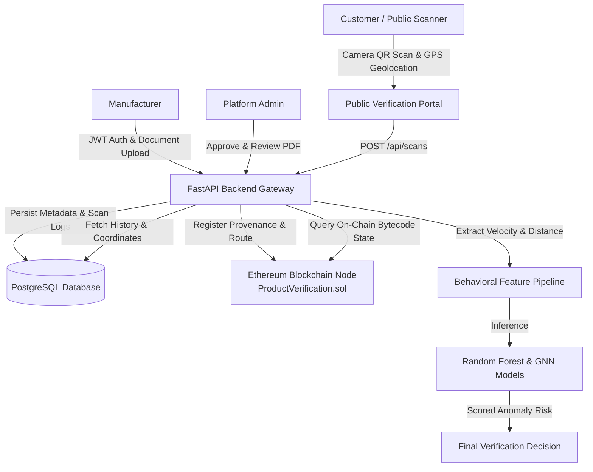

# 🔐 AuthentiQ — AI & Blockchain Anti-Counterfeit Product Verification System

[](LICENSE)
[](https://www.python.org/)
[](https://nextjs.org/)
[](https://www.postgresql.org/)
[](https://soliditylang.org/)

AuthentiQ is a full-stack, enterprise-grade anti-counterfeit platform combining **FastAPI**, **PostgreSQL**, **Solidity Smart Contracts (Hardhat/Ganache)**, **HTML5 Browser Geolocation & Camera QR Scanning**, and **Dual AI Behavioral Models (Random Forest + GNN)** to combat counterfeit goods and QR cloning.

---

## 🎯 Problem Statement & Solution

### Problem
Physical QR codes printed on product packaging can be easily copied or cloned by counterfeiters. While standard database or on-chain verification confirms that a product identifier is valid, it cannot prevent a cloned QR code from being scanned thousands of times across geographically impossible locations.

### Solution
AuthentiQ introduces a **Hybrid Dual-Verification System**:
1. **Cryptographic Identity Verification**: Confirms product registration and hash authenticity on the persistent local Ethereum-compatible blockchain (`ProductVerification.sol`).
2. **AI Behavioral Anomaly Detection**: Analyzes real device GPS coordinates, scan frequency velocity, time deltas, and geographic distance using Haversine calculation to detect impossible travel speed (>800 km/h) and duplicate QR cloning.

> **Note on Cryptographic Isolation**: AI behavioral detection acts as an evidence-based fraud indicator. A cloned QR code scanning a genuine product identity will trigger an AI `COUNTERFEIT` verdict due to impossible velocity without altering the immutable smart contract record.

---

## 🏗️ System Architecture



---

## 📦 System Architecture & Technology Stack

- **Backend Gateway**: FastAPI, Python 3.11, Pydantic V2, SQLAlchemy ORM, Uvicorn
- **Database**: PostgreSQL 16 (Relational storage for users, manufacturers, products, scan history, audit logs)
- **Blockchain**: Solidity 0.8.20, Hardhat, Persistent Ganache Node (`http://127.0.0.1:8545`, Chain ID `1337`, `./chain_data`)
- **Web3 Integration**: Web3.py (`blockchain_service.py`), OpenZeppelin `AccessControl`
- **Frontend Portal**: Next.js 16 (App Router), React, TypeScript, Vanilla CSS, Tailwind CSS, `html5-qrcode` Camera Scanner, HTML5 Geolocation API
- **AI & ML Engine**: Scikit-Learn (Random Forest Classifier), PyTorch / PyTorch Geometric (Graph Neural Network), Haversine Distance Engine

---

## 📁 Repository Structure

```text
authentiq-backend/
├── backend/                        # FastAPI Backend Service
│   ├── app/
│   │   ├── main.py                 # FastAPI application entrypoint
│   │   ├── core/                   # Security, JWT, RBAC, config
│   │   ├── database/               # PostgreSQL connection & migrations
│   │   ├── models/                 # SQLAlchemy DB models (User, Manufacturer, Product, Scan, Location, Audit)
│   │   ├── schemas/                # Pydantic schemas
│   │   ├── services/               # Scan service, Blockchain service, AI client
│   │   ├── routers/                # API Endpoints (auth, admin, products, scans, verify, health)
│   │   ├── contracts/              # Compiled ProductVerification.json ABI
│   │   └── seed_admin.py           # Admin account seeder
│   ├── tests/                      # Pytest unit & integration test suite (54/54 passed)
│   └── requirements.txt            # Python dependencies
├── frontend/                       # Next.js 16 Web Application
│   ├── src/app/
│   │   ├── page.tsx                # Landing page
│   │   ├── verify/page.tsx         # Public QR Scan & GPS Verification Console
│   │   ├── admin/page.tsx          # Governance & Manufacturer PDF Review Dashboard
│   │   ├── dashboard/page.tsx      # Manufacturer Product Management Console
│   │   ├── login/page.tsx          # Role-based Login Portal
│   │   └── utils/                  # API client & auth handlers
│   └── package.json
├── blockchain/                     # Canonical Smart Contract & Hardhat Workspace
│   ├── contracts/
│   │   └── ProductVerification.sol # ERC-721 provenance smart contract
│   ├── scripts/
│   │   └── deploy.js               # Bytecode verification & deployment script
│   ├── hardhat.config.js           # Hardhat network configuration
│   └── package.json
├── docs/                           # System architecture specifications & guides
├── scratch/                        # Live E2E test scripts (`test_live_e2e_flow.py`)
├── start-project.ps1               # Automated Windows PowerShell system orchestrator
├── stop-project.ps1                # Safe process termination script
├── .env.example                    # Environment template with non-secret placeholders
├── .gitignore                      # Git exclusion rules protecting secrets, logs, chain_data
└── README.md                       # Repository documentation
```

---

## 🚀 Quick Start Guide

### 1. Prerequisites
- **Python 3.11+**
- **Node.js 18+ & npm**
- **Docker** (for PostgreSQL container)

### 2. Environment Configuration
Copy the environment template in `backend/.env.example` to `backend/.env`:
```bash
cp backend/.env.example backend/.env
```
*(Ensure `DATABASE_URL`, `RPC_URL="http://127.0.0.1:8545"`, and `CHAIN_ID=1337` are set)*.

### 3. Start System (Automated Orchestrator)
Run the PowerShell orchestrator:
```powershell
.\start-project.ps1
```
This script automatically:
1. Verifies PostgreSQL database container.
2. Launches persistent Ganache blockchain node on port `8545`.
3. Checks smart contract bytecode (`0xfacFC484fF44B0D12f053571089098D389374601`).
4. Seeds default admin credentials (`admin@authentiq.com`).
5. Launches FastAPI backend gateway at `http://127.0.0.1:8000`.
6. Launches Next.js frontend portal at `http://localhost:3000`.

---

## 📡 Key Verified API Endpoints

| Method | Endpoint | Description | Auth Required |
| :--- | :--- | :--- | :--- |
| `GET` | `/api/health` | Service gateway & PostgreSQL status | None |
| `GET` | `/api/health/blockchain` | Blockchain RPC reachability & contract state | None |
| `POST` | `/api/auth/login` | Authenticate user & issue JWT token | None |
| `POST` | `/api/auth/manufacturer/register` | Register manufacturer with PDF document | None |
| `GET` | `/api/admin/manufacturers` | List manufacturer applications | Admin |
| `GET` | `/api/admin/manufacturers/{id}/document` | Stream uploaded PDF/image document | Admin |
| `PUT` | `/api/admin/manufacturers/{id}/status` | Approve/Reject/Suspend manufacturer | Admin |
| `POST` | `/api/products/register` | Register product on PostgreSQL & Blockchain | Manufacturer |
| `GET` | `/api/verify/{qr_code}` | Public hybrid Database + Blockchain check | None |
| `POST` | `/api/scans` | Submit QR scan with GPS coordinates for AI evaluation | None |
| `GET` | `/api/scans/history/{product_id}` | Fetch scan history logs for a product | None |

---

## 📊 Verification & Automated Test Results

### 1. Backend Test Suite (`pytest`)
```powershell
cd backend
python -m pytest tests/ -v
```
**Result**: **54/54 PASSED**

### 2. Next.js Production Build
```powershell
cd frontend
npm run build
```
**Result**: **100% SUCCESS** (0 TypeScript errors)

### 3. Live End-to-End Test Suite (`test_live_e2e_flow.py`)
```powershell
python scratch/test_live_e2e_flow.py
```
**Result**:
- System Health: `healthy` (PostgreSQL Connected, Blockchain `HEALTHY` at `0xfacFC484fF44B0D12f053571089098D389374601`).
- Manufacturer PDF Document Access: Verified stream & headers (`application/pdf`).
- Blockchain Registration: Verified transaction hash & block number confirmation.
- Real Geolocation & AI Analysis: Normal scan (Mumbai) -> `GENUINE`; Impossible travel scan (London, 7,191 km away in <1 min) -> `COUNTERFEIT` (`Impossible Travel Speed / Duplicated QR Code Detected`).

---

## 🔐 Security & Secret Protection Hygiene

- All credentials, private keys, database connection strings, JWT signing keys, and mnemonics are strictly supplied via gitignored `.env` files.
- `.gitignore` prevents staging of secrets, local uploaded documents (`uploads/*`), local database files (`*.db`, `*.sqlite`), node modules, build artifacts, and persistent chain data (`chain_data/`).
- `.env.example` templates contain non-secret placeholders for reproducible deployment.

---

## 📄 License

License: Not specified
